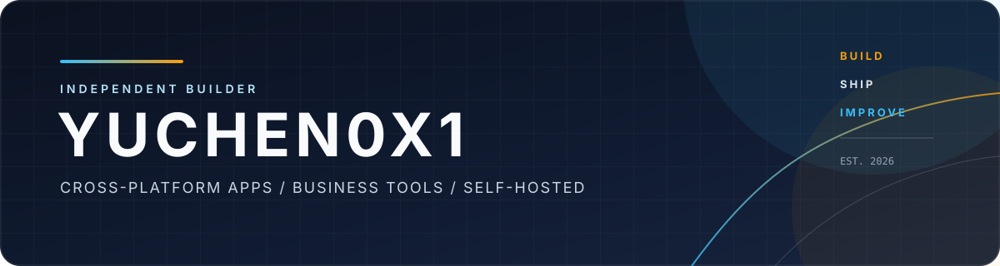

  <b>冷漠不是神</b> &nbsp;·&nbsp; 独立开发者 
  <a href="https://github.com/yuchen0x1"><b>GitHub</b></a> &nbsp;·&nbsp;
  <a href="https://gitee.com/yuchen0x1"><b>Gitee</b></a> &nbsp;·&nbsp;
  <a href="https://lenmo.top"><b>lenmo.top</b></a>

---

##  01 · PROFILE

我喜欢把模糊的需求拆成清晰的系统，把重复的工作变成可靠的工具。

比起追逐热点，我更在意一件事能不能长期跑下去：边界是否清楚、过程是否可观测、服务是否可持续维护。

> Build quietly. Ship clearly. Keep improving.
>
> — 冷漠不是神，独立开发者

---

##  02 · WHAT I BUILD

<table>
  <tr>
    <td width="25%" valign="top">
      <b>AI-Native Tools</b> 
      AI 写作 · AI 浏览器 · AI 网关 · AI 编码工作台
    </td>
    <td width="25%" valign="top">
      <b>Business Tools</b> 
      电商与二手交易运营：自动发货、消息处理、多账号管理
    </td>
    <td width="25%" valign="top">
      <b>Cross-platform Apps</b> 
      桌面与移动端：媒体播放下载、开发者协作工具
    </td>
    <td width="25%" valign="top">
      <b>Self-hosted Web</b> 
      可自部署的在线服务：实时协作、内容解析、PWA、Docker 部署
    </td>
  </tr>
</table>

---

##  03 · SELECTED PROJECTS

###  AI 与智能工具

<table>
  <tr>
    <td width="20%" valign="top"><a href="https://github.com/yuchen0x1/Pagekin"><b>Pagekin</b></a></td>
    <td valign="top">书童 Pagekin：开源免费的 AI 小说写作桌面软件，本地知识库与向量化检索</td>
    <td width="14%" valign="top"><code>TypeScript</code></td>
    <td width="14%" valign="top" align="right">● 正常更新</td>
  </tr>
  <tr>
    <td valign="top"><a href="https://github.com/yuchen0x1/aa-browser"><b>aa-browser</b></a></td>
    <td valign="top">为 Agent 而生的浏览器：MCP 驱动、结构化快照、增量省 token 与网络抓包</td>
    <td valign="top"><code>TypeScript</code></td>
    <td valign="top" align="right">● 正常更新</td>
  </tr>
  <tr>
    <td valign="top"><a href="https://github.com/yuchen0x1/AI-generates-E-language-code"><b>AI-generates-E-language-code</b></a></td>
    <td valign="top">易语言 AI 一体化工作台：纯文本源码与易语言工程双向转换、自动化编译</td>
    <td valign="top"><code>CSS</code></td>
    <td valign="top" align="right">● 正常更新</td>
  </tr>
  <tr>
    <td valign="top"><a href="https://github.com/yuchen0x1/sub3api-relay"><b>sub3api-relay</b></a></td>
    <td valign="top">AI API 网关与管理平台：多供应商中转、账号调度、用量计费与运维监控</td>
    <td valign="top"><code>Go</code></td>
    <td valign="top" align="right">● 正常更新</td>
  </tr>
</table>

###  桌面与移动应用

<table>
  <tr>
    <td width="20%" valign="top"><a href="https://github.com/yuchen0x1/HongGuo-PC"><b>HongGuo-PC</b></a></td>
    <td valign="top">红果短剧 Windows/Mac 桌面端：播放与下载（GPL-3.0 二次开发版）</td>
    <td width="14%" valign="top"><code>JavaScript</code></td>
    <td width="14%" valign="top" align="right">● 正常更新</td>
  </tr>
  <tr>
    <td valign="top"><a href="https://github.com/yuchen0x1/Gitee-Android"><b>Gitee-Android</b></a></td>
    <td valign="top">Gitee 安卓客户端：仓库动态、Issue 回复与 PR 审阅的移动协作，直连官方 API，无自建后端</td>
    <td valign="top"><code>Dart</code></td>
    <td valign="top" align="right">● 正常更新</td>
  </tr>
  <tr>
    <td valign="top"><a href="https://github.com/yuchen0x1/Base64-encode-encoding"><b>Base64-encode-encoding</b></a></td>
    <td valign="top">Base64 编解码工具箱：Electron 与 Capacitor 多端离线工具集</td>
    <td valign="top"><code>Vue</code></td>
    <td valign="top" align="right">● 正常更新</td>
  </tr>
  <tr>
    <td valign="top"><a href="https://github.com/yuchen0x1/Codex-Remote-Bridge"><b>Codex-Remote-Bridge</b></a></td>
    <td valign="top">手机遥控电脑 Codex Desktop：局域网直连，配对码与一次性令牌</td>
    <td valign="top"><code>JavaScript</code></td>
    <td valign="top" align="right">● 正常更新</td>
  </tr>
  <tr>
    <td valign="top"><a href="https://github.com/yuchen0x1/Qzone-Archive"><b>Qzone-Archive</b></a></td>
    <td valign="top">空间归档：本地 QQ 空间归档工具（Tauri 2 + Vue 3）</td>
    <td valign="top"><code>Rust</code></td>
    <td valign="top" align="right">● 正常更新</td>
  </tr>
</table>

###  业务与运营工具

<table>
  <tr>
    <td width="20%" valign="top"><a href="https://github.com/yuchen0x1/Xianyu-Assistant"><b>Xianyu-Assistant</b></a></td>
    <td valign="top">闲鱼卖家运营控制台：账号连接、商品管理、消息处理、自动回复、自动发货、卡密库存、任务调度与运行监控，支持多账号</td>
    <td width="14%" valign="top"><code>Java</code></td>
    <td width="14%" valign="top" align="right">● 正常更新</td>
  </tr>
  <tr>
    <td valign="top"><a href="https://github.com/yuchen0x1/AI-QQ-Bot"><b>AI-QQ-Bot</b></a></td>
    <td valign="top">QBot 多账号智能 QQ 机器人平台：双通道接入、AI 多供应商对话、群管理与自动审核</td>
    <td valign="top"><code>Python</code></td>
    <td valign="top" align="right">● 正常更新</td>
  </tr>
</table>

###  自托管服务

<table>
  <tr>
    <td width="20%" valign="top"><a href="https://github.com/yuchen0x1/JukeboxRoom"><b>JukeboxRoom</b></a></td>
    <td valign="top">多人音乐房间与个人音乐工作区（Web / Windows / Android）</td>
    <td width="14%" valign="top"><code>TypeScript</code></td>
    <td width="14%" valign="top" align="right">● 正常更新</td>
  </tr>
  <tr>
    <td valign="top"><a href="https://github.com/yuchen0x1/Short-Video-Analysis"><b>Short-Video-Analysis</b></a></td>
    <td valign="top">短视频无水印解析与下载（抖音 / B站 / 快手 / TikTok），支持自托管</td>
    <td valign="top"><code>PHP</code></td>
    <td valign="top" align="right">● 正常更新</td>
  </tr>
  <tr>
    <td valign="top"><a href="https://github.com/yuchen0x1/Xray-server-management-panel"><b>Xray-server-management-panel</b></a></td>
    <td valign="top">Xray 服务器管理面板：多节点同步、多渠道告警与订阅自助导入</td>
    <td valign="top"><code>Go</code></td>
    <td valign="top" align="right">● 正常更新</td>
  </invoke>
  </tr>
  <tr>
    <td valign="top"><a href="https://github.com/yuchen0x1/baidu-tieba-yunqiandao"><b>baidu-tieba-yunqiandao</b></a></td>
    <td valign="top">百度贴吧云签到：计划任务签到、失败复签、凭据健康检查与通知推送</td>
    <td valign="top"><code>PHP</code></td>
    <td valign="top" align="right">● 正常更新</td>
  </tr>
</table>

###  开发辅助与调试

<table>
  <tr>
    <td width="20%" valign="top"><a href="https://github.com/yuchen0x1/OpenWrt-Flashing-Guide-RE-CP02"><b>OpenWrt-Flashing-Guide-RE-CP02</b></a></td>
    <td valign="top">京东云无线宝 RE-CP-02 刷 OpenWrt 图文教程、自制 LuCI 应用与自有 OTA 更新源</td>
    <td width="14%" valign="top"><code>JavaScript</code></td>
    <td width="14%" valign="top" align="right">● 正常更新</td>
  </tr>
  <tr>
    <td valign="top"><a href="https://github.com/yuchen0x1/linuxdoAndroid"><b>linuxdoAndroid</b></a></td>
    <td valign="top">linux.do Android CDP 调试脚本集：Cookie 提取与页面表达式求值</td>
    <td valign="top"><code>JavaScript</code></td>
    <td valign="top" align="right">● 正常更新</td>
  </tr>
</table>

  <a href="https://github.com/yuchen0x1?tab=repositories"><b>查看全部 GitHub 项目 →</b></a>

---

##  04 · STACK

<table>
  <tr>
    <td width="33%" valign="top"><code>Go · Rust · Java · Python · TypeScript · JavaScript · Dart · PHP</code></td>
    <td width="34%" valign="top"><code>Vue · React · Spring Boot · Laravel · Electron · Tauri · Flutter · Capacitor</code></td>
    <td width="33%" valign="top"><code>Tailwind CSS · Vite · Express · Socket.IO · PostgreSQL · Redis · MCP · Docker · PWA</code></td>
  </tr>
</table>

---

##  05 · CONTACT

<table>
  <tr>
    <td width="33%" align="center" valign="top">
      
      <a href="https://github.com/yuchen0x1"><b>GITHUB</b></a> 
      github.com/yuchen0x1
    </td>
    <td width="33%" align="center" valign="top">
      
      <a href="https://gitee.com/yuchen0x1"><b>GITEE</b></a> 
      gitee.com/yuchen0x1
    </td>
    <td width="34%" align="center" valign="top">
      
      <a href="https://lenmo.top"><b>WEBSITE</b></a> 
      lenmo.top
    </td>
  </tr>
</table>

---

  Designed for clarity · Built for the long run

