  <b>冷漠不是神</b> &nbsp;·&nbsp; 独立开发者 
  <a href="https://github.com/yuchen0x1"><b>GitHub</b></a> &nbsp;·&nbsp;
  <a href="https://gitee.com/yuchen0x1"><b>Gitee</b></a> &nbsp;·&nbsp;
  <a href="https://lenmo.top"><b>lenmo.top</b></a>

---

##  01 · PROFILE

我喜欢把模糊的需求拆成清晰的系统，把重复的工作变成可靠的工具。

比起追逐热点，我更在意一件事能不能长期跑下去：边界是否清楚、过程是否可观测、服务是否可持续维护。

> Build quietly. Ship clearly. Keep improving.
>
> — 冷漠不是神，独立开发者

---

##  02 · WHAT I BUILD

<table>
  <tr>
    <td width="25%" valign="top">
      <b>AI-Native Tools</b> 
      AI 写作 · Agent 浏览器 · 模型评测 · API 网关 · 开发工作台
    </td>
    <td width="25%" valign="top">
      <b>Business Tools</b> 
      电商与社群运营：自动发货、消息处理、多账号管理
    </td>
    <td width="25%" valign="top">
      <b>Cross-platform Apps</b> 
      桌面与移动端：安卓运行、媒体与音频处理、网络诊断、离线知识
    </td>
    <td width="25%" valign="top">
      <b>Self-hosted Web</b> 
      可自部署的在线服务：实时协作、内容解析、族谱管理、Docker 部署
    </td>
  </tr>
</table>

---

##  03 · PROJECTS

截至 **2026-11-23**，个人账号有 **33 个公开仓库 · 32 个项目**（含 2 个 Fork）；另有 3 个已迁移到 `Indifference-Project` 组织的公开归档项目。本页索引共 **36 个公开仓库 · 35 个项目**，项目状态与主要语言按 GitHub 公开信息整理。

###  AI 与智能工具

<table>
  <tr>
    <td width="20%" valign="top"><a href="https://github.com/yuchen0x1/Novel-Writer-master"><b>Novel-Writer-master</b></a> <a href="https://github.com/yuchen0x1/Novel-Writer-master/releases/latest">最新发行</a></td>
    <td valign="top">AI 小说写作桌面软件：本地知识库、大纲人物卡与从章节创作到审稿修稿的工作流</td>
    <td width="14%" valign="top"><code>TypeScript</code></td>
    <td width="14%" valign="top" align="right">● 未归档</td>
  </tr>
  <tr>
    <td valign="top"><a href="https://github.com/yuchen0x1/aa-browser"><b>aa-browser</b></a> <a href="https://github.com/yuchen0x1/aa-browser/releases/latest">最新发行</a></td>
    <td valign="top">为 Agent 而生的桌面浏览器：MCP 接入、结构化快照与网络抓包</td>
    <td valign="top"><code>TypeScript</code></td>
    <td valign="top" align="right">● 未归档</td>
  </tr>
  <tr>
    <td valign="top"><a href="https://github.com/yuchen0x1/mind-bench"><b>MIND BENCH</b></a> <a href="https://github.com/yuchen0x1/mind-bench/releases/latest">最新发行</a></td>
    <td valign="top">本地 AI 模型评测工作台：多模型对比、规则评分、AI 裁判与评测报告</td>
    <td valign="top"><code>JavaScript</code></td>
    <td valign="top" align="right">● 未归档</td>
  </tr>
  <tr>
    <td valign="top"><a href="https://github.com/yuchen0x1/PROJECT-NEXUS"><b>PROJECT NEXUS</b></a> <a href="https://github.com/yuchen0x1/PROJECT-NEXUS/releases/latest">最新发行</a></td>
    <td valign="top">Windows AI 仓库运营工作台：仓库监控与开发流程管理；当前为开发预览版</td>
    <td valign="top"><code>JavaScript</code></td>
    <td valign="top" align="right">● 未归档</td>
  </tr>
  <tr>
    <td valign="top"><a href="https://github.com/yuchen0x1/sub3api-relay"><b>sub3api-relay</b></a> <a href="https://github.com/yuchen0x1/sub3api-relay/releases/latest">最新发行</a></td>
    <td valign="top">AI API 网关与管理平台：多供应商中转、账号调度、用量计费与运维监控</td>
    <td valign="top"><code>Go</code></td>
    <td valign="top" align="right">● 未归档</td>
  </tr>
</table>

###  桌面与移动应用

<table>
  <tr>
    <td width="20%" valign="top"><a href="https://github.com/yuchen0x1/apkstart"><b>ApkStart</b></a> <a href="https://github.com/yuchen0x1/apkstart/releases/latest">最新发行</a></td>
    <td valign="top">Windows 安卓应用运行器：APK 双击安装、独立窗口运行、运行时管理与在线更新</td>
    <td width="14%" valign="top"><code>JavaScript</code></td>
    <td width="14%" valign="top" align="right">● 未归档</td>
  </tr>
  <tr>
    <td width="20%" valign="top"><a href="https://github.com/yuchen0x1/HongGuo-PC"><b>HongGuo-PC</b></a> <a href="https://github.com/yuchen0x1/HongGuo-PC/releases/latest">最新发行</a></td>
    <td valign="top">红果短剧 Windows 桌面端：搜索、播放、下载、追剧与合并导出（GPL-3.0 二次开发版）</td>
    <td width="14%" valign="top"><code>JavaScript</code></td>
    <td width="14%" valign="top" align="right">● 未归档</td>
  </tr>
  <tr>
    <td valign="top"><a href="https://github.com/yuchen0x1/Gitee-Android"><b>Gitee-Android</b></a> <a href="https://github.com/yuchen0x1/Gitee-Android/releases/latest">最新发行</a></td>
    <td valign="top">Gitee 非官方安卓客户端：仓库动态、代码浏览、Issue 回复与 PR 审阅</td>
    <td valign="top"><code>Dart</code></td>
    <td valign="top" align="right">● 未归档</td>
  </tr>
  <tr>
    <td valign="top"><a href="https://github.com/yuchen0x1/LINUX-DO"><b>LINUX-DO</b></a> <a href="https://github.com/yuchen0x1/LINUX-DO/releases/latest">最新发行</a></td>
    <td valign="top">LINUX DO 非官方 Android 客户端：话题、发帖回复、私信通知、书签与代理设置</td>
    <td valign="top"><code>Dart</code></td>
    <td valign="top" align="right">● 未归档</td>
  </tr>
  <tr>
    <td valign="top"><a href="https://github.com/yuchen0x1/Base64-encode-encoding"><b>极客工具箱</b></a> <a href="https://github.com/yuchen0x1/Base64-encode-encoding/releases/latest">最新发行</a></td>
    <td valign="top">极客工具箱：离线开发者工具集，内置 21 款工具，数据在本机处理</td>
    <td valign="top"><code>JavaScript</code></td>
    <td valign="top" align="right">● 未归档</td>
  </tr>
  <tr>
    <td valign="top"><a href="https://github.com/yuchen0x1/Audio-Studio"><b>Audio Studio</b></a> <a href="https://github.com/yuchen0x1/Audio-Studio/releases/latest">最新发行</a></td>
    <td valign="top">音频处理工具：格式转换、批量处理、剪辑合并、元数据与封面编辑</td>
    <td valign="top"><code>TypeScript</code></td>
    <td valign="top" align="right">● 未归档</td>
  </tr>
  <tr>
    <td valign="top"><a href="https://github.com/yuchen0x1/Internet-Speed-Test"><b>NetVision Pro</b></a> <a href="https://github.com/yuchen0x1/Internet-Speed-Test/releases/latest">最新发行</a></td>
    <td valign="top">Windows 网络测速与诊断：多协议测速、网络质量分析、网卡监控与历史报告</td>
    <td valign="top"><code>Rust</code></td>
    <td valign="top" align="right">● 未归档</td>
  </tr>
  <tr>
    <td valign="top"><a href="https://github.com/yuchen0x1/Scan-the-computer-for-viruses"><b>PC Security Center</b></a> <a href="https://github.com/yuchen0x1/Scan-the-computer-for-viruses/releases/latest">最新发行</a></td>
    <td valign="top">Windows 安全管家：接入 Microsoft Defender，提供安全检查、系统维护与本地报告</td>
    <td valign="top"><code>C#</code></td>
    <td valign="top" align="right">● 未归档</td>
  </tr>
  <tr>
    <td valign="top"><a href="https://github.com/yuchen0x1/Doomsday-Survival-Guide"><b>末日生存指南</b></a> <a href="https://github.com/yuchen0x1/Doomsday-Survival-Guide/releases/latest">最新发行</a></td>
    <td valign="top">离线优先的生存知识检索与物资管理系统，提供图鉴、清单与计算器</td>
    <td valign="top"><code>TypeScript</code></td>
    <td valign="top" align="right">● 未归档</td>
  </tr>
  <tr>
    <td valign="top"><a href="https://github.com/yuchen0x1/GitHub-Achievement-Hub"><b>GitHub Achievement Hub</b></a> <a href="https://github.com/yuchen0x1/GitHub-Achievement-Hub/releases/latest">最新发行</a></td>
    <td valign="top">GitHub 成就勋章百科：获取条件、等级门槛、可信来源与进度追踪</td>
    <td valign="top"><code>TypeScript</code></td>
    <td valign="top" align="right">● 未归档</td>
  </tr>
  <tr>
    <td valign="top"><a href="https://github.com/yuchen0x1/SubtitleFlow"><b>SubtitleFlow</b></a> <a href="https://github.com/yuchen0x1/SubtitleFlow/releases/latest">最新发行</a></td>
    <td valign="top">Chrome 和 Edge 双语字幕扩展，支持网页原生字幕、字幕文件、跟随播放的字幕层，以及可选的 Whisper 语音识别和翻译。</td>
    <td valign="top"><code>TypeScript</code></td>
    <td valign="top" align="right">● 未归档</td>
  </tr>
  <tr>
    <td valign="top"><a href="https://github.com/yuchen0x1/authenticator-desk"><b>Authenticator Desk</b></a> <a href="https://github.com/yuchen0x1/authenticator-desk/releases/latest">最新发行</a></td>
    <td valign="top">Windows 离线验证码工具，支持 TOTP、HOTP 与本地加密备份。</td>
    <td valign="top"><code>Rust</code></td>
    <td valign="top" align="right">● 未归档</td>
  </tr>
  <tr>
    <td valign="top"><a href="https://github.com/yuchen0x1/LUMORA-Camera"><b>LUMORA Camera</b></a> <a href="https://github.com/yuchen0x1/LUMORA-Camera/releases/latest">最新发行</a></td>
    <td valign="top">Android 本地摄影应用：手动拍摄、胶片预设与非破坏性照片编辑；v2.1.7 为正式签名稳定版</td>
    <td valign="top"><code>Kotlin</code></td>
    <td valign="top" align="right">● 未归档</td>
  </tr>
  <tr>
    <td valign="top"><a href="https://github.com/yuchen0x1/VoxMaster-AI"><b>VoxMaster AI</b></a> <a href="https://github.com/yuchen0x1/VoxMaster-AI/releases/latest">最新发行</a></td>
    <td valign="top">Windows 本地喊麦调音工作站：测量驱动调音、音高与尾音编辑、可选人声分离及多轨混音</td>
    <td valign="top"><code>Python</code></td>
    <td valign="top" align="right">● 未归档</td>
  </tr>
  <tr>
    <td valign="top"><a href="https://github.com/yuchen0x1/XiaFlow"><b>匣流 XiaFlow</b></a> <a href="https://github.com/yuchen0x1/XiaFlow/releases/latest">最新发行</a></td>
    <td valign="top">Windows 文件压缩与归档管理器：批量处理、自动备份、文件校验与任务调度</td>
    <td valign="top"><code>C#</code></td>
    <td valign="top" align="right">● 未归档</td>
  </tr>
</table>

###  业务与运营工具

<table>
  <tr>
    <td width="20%" valign="top"><a href="https://github.com/yuchen0x1/Xianyu-Assistant"><b>Xianyu-Assistant</b></a> <a href="https://github.com/yuchen0x1/Xianyu-Assistant/releases/latest">最新发行</a></td>
    <td valign="top">闲鱼卖家运营控制台：多账号、商品消息、自动回复发货与卡密库存，电脑手机均可用浏览器访问</td>
    <td width="14%" valign="top"><code>Java</code></td>
    <td width="14%" valign="top" align="right">● 未归档</td>
  </tr>
  <tr>
    <td valign="top"><a href="https://github.com/yuchen0x1/AI-QQ-Bot"><b>AI-QQ-Bot</b></a> <a href="https://github.com/yuchen0x1/AI-QQ-Bot/releases/latest">最新发行</a></td>
    <td valign="top">QBot 多账号 QQ 机器人平台：官方机器人与 OneBot 兼容通道、AI 对话、群管理与自动审核</td>
    <td valign="top"><code>Python</code></td>
    <td valign="top" align="right">● 未归档</td>
  </tr>
</table>

###  自托管服务

<table>
  <tr>
    <td width="20%" valign="top"><a href="https://github.com/yuchen0x1/JukeboxRoom"><b>JukeboxRoom</b></a> <a href="https://github.com/yuchen0x1/JukeboxRoom/releases/latest">最新发行</a></td>
    <td valign="top">多人音乐房间与个人音乐工作区：点歌队列、播放进度同步、歌词与聊天</td>
    <td width="14%" valign="top"><code>TypeScript</code></td>
    <td width="14%" valign="top" align="right">● 未归档</td>
  </tr>
  <tr>
    <td valign="top"><a href="https://github.com/yuchen0x1/Short-Video-Analysis"><b>Short-Video-Analysis</b></a> <a href="https://github.com/yuchen0x1/Short-Video-Analysis/releases/latest">最新发行</a></td>
    <td valign="top">短视频解析与下载工具：视频、图集、封面与作者信息，支持自托管及 HTTP API</td>
    <td valign="top"><code>PHP</code></td>
    <td valign="top" align="right">● 未归档</td>
  </tr>
  <tr>
    <td valign="top"><a href="https://github.com/yuchen0x1/Xray-server-management-panel"><b>Xray-server-management-panel</b></a> <a href="https://github.com/yuchen0x1/Xray-server-management-panel/releases/latest">最新发行</a></td>
    <td valign="top">Xray 服务器管理面板：入站订阅、多节点同步、路由规则、流量监控与多渠道告警</td>
    <td valign="top"><code>Go</code></td>
    <td valign="top" align="right">● 未归档</td>
  </tr>
  <tr>
    <td valign="top"><a href="https://github.com/yuchen0x1/baidu-tieba-yunqiandao"><b>baidu-tieba-yunqiandao</b></a> <a href="https://github.com/yuchen0x1/baidu-tieba-yunqiandao/releases/latest">最新发行</a></td>
    <td valign="top">百度贴吧云签到：计划任务签到、失败复签、凭据健康检查与通知推送</td>
    <td valign="top"><code>PHP</code></td>
    <td valign="top" align="right">● 未归档</td>
  </tr>
  <tr>
    <td valign="top"><a href="https://github.com/yuchen0x1/Family-Genealogy-of-Hundreds-of-Clans"><b>百家姓与家族族谱</b></a> <a href="https://github.com/yuchen0x1/Family-Genealogy-of-Hundreds-of-Clans/releases/latest">最新发行</a></td>
    <td valign="top">中华姓氏文化与家族族谱平台：姓氏知识库、家族树、亲属关系图与 GEDCOM 数据导入导出</td>
    <td valign="top"><code>TypeScript</code></td>
    <td valign="top" align="right">● 未归档</td>
  </tr>
</table>

###  开发辅助与调试

<table>
  <tr>
    <td width="20%" valign="top"><a href="https://github.com/yuchen0x1/OpenWrt-Flashing-Guide-RE-CP02"><b>OpenWrt-Flashing-Guide-RE-CP02</b></a> <a href="https://github.com/yuchen0x1/OpenWrt-Flashing-Guide-RE-CP02/releases/latest">最新发行</a></td>
    <td valign="top">京东云无线宝 RE-CP-02 刷 OpenWrt 图文教程、自制 LuCI 应用与 OTA 更新源</td>
    <td width="14%" valign="top"><code>JavaScript</code></td>
    <td width="14%" valign="top" align="right">● 未归档</td>
  </tr>
  <tr>
    <td valign="top"><a href="https://github.com/yuchen0x1/yuchen0x1.github.io"><b>开发者作品集</b></a> <a href="https://github.com/yuchen0x1/yuchen0x1.github.io/releases/latest">最新发行</a></td>
    <td valign="top">yuchen0x1 的中英双语作品集，通过公开 GitHub 数据展示项目、仓库排行、提交动态和开发时间线。</td>
    <td valign="top"><code>TypeScript</code></td>
    <td valign="top" align="right">● 未归档</td>
  </tr>
  <tr>
    <td valign="top"><a href="https://github.com/yuchen0x1/CodeDoctor"><b>CodeDoctor</b></a> <a href="https://github.com/yuchen0x1/CodeDoctor/releases/latest">最新发行</a></td>
    <td valign="top">Windows 离线代码质量体检：静态分析、架构关系、历史报告与治理提示词</td>
    <td valign="top"><code>Rust</code></td>
    <td valign="top" align="right">● 未归档</td>
  </tr>
</table>

###  组织归档项目

以下项目已从个人账号迁移到 [Indifference-Project](https://github.com/Indifference-Project)，保留在索引中以便追溯；归档状态以组织仓库为准。

<table>
  <tr>
    <td width="20%" valign="top"><a href="https://github.com/Indifference-Project/Qzone-Archive"><b>Qzone-Archive</b></a></td>
    <td valign="top">QQ 空间本地归档工具：动态、照片、视频与互动记录保存到 SQLite，并支持离线导出</td>
    <td width="14%" valign="top"><code>Rust</code></td>
    <td width="14%" valign="top" align="right">○ 已归档</td>
  </tr>
  <tr>
    <td valign="top"><a href="https://github.com/Indifference-Project/Codex-Remote-Bridge"><b>Codex-Remote-Bridge</b></a></td>
    <td valign="top">手机与电脑 Codex Desktop 的本地桥接；最终版本源码与安装包留作查阅</td>
    <td valign="top"><code>JavaScript</code></td>
    <td valign="top" align="right">○ 已归档</td>
  </tr>
  <tr>
    <td valign="top"><a href="https://github.com/Indifference-Project/themes"><b>themes</b></a></td>
    <td valign="top">Radix Themes 组件库 Fork：面向快速开发、易维护与可访问性的 React 组件库</td>
    <td valign="top"><code>TypeScript</code></td>
    <td valign="top" align="right">○ 已归档</td>
  </tr>
</table>

###  Fork 项目

<table>
  <tr>
    <td width="20%" valign="top"><a href="https://github.com/yuchen0x1/GFPGAN"><b>GFPGAN</b></a></td>
    <td valign="top">GFPGAN 维护版：兼容现代 PyTorch 与 torchvision 的真实人脸修复，支持 CPU 与纯 PyTorch 回退</td>
    <td width="14%" valign="top"><code>Python</code></td>
    <td width="14%" valign="top" align="right">⑂ Fork</td>
  </tr>
  <tr>
    <td valign="top"><a href="https://github.com/yuchen0x1/arco-design"><b>arco-design</b></a></td>
    <td valign="top">Arco Design React 组件库 Fork</td>
    <td valign="top"><code>未检测到</code></td>
    <td valign="top" align="right">⑂ Fork</td>
  </tr>
</table>

  <a href="https://github.com/yuchen0x1?tab=repositories"><b>查看全部 GitHub 项目 →</b></a>

---

##  04 · STACK

<table>
  <tr>
    <td width="33%" valign="top"><code>Go · Rust · Java · Python · TypeScript · JavaScript · Dart · PHP · C# · Kotlin</code></td>
    <td width="34%" valign="top"><code>Vue · React · Spring Boot · Laravel · Electron · Tauri · Flutter · Capacitor · .NET · WPF</code></td>
    <td width="33%" valign="top"><code>Tailwind CSS · Vite · Express · Socket.IO · PostgreSQL · Redis · MCP · Docker · PWA</code></td>
  </tr>
</table>

---

##  05 · CONTACT

<table>
  <tr>
    <td width="33%" align="center" valign="top">
      
      <a href="https://github.com/yuchen0x1"><b>GITHUB</b></a> 
      github.com/yuchen0x1
    </td>
    <td width="33%" align="center" valign="top">
      
      <a href="https://gitee.com/yuchen0x1"><b>GITEE</b></a> 
      gitee.com/yuchen0x1
    </td>
    <td width="34%" align="center" valign="top">
      
      <a href="https://lenmo.top"><b>WEBSITE</b></a> 
      lenmo.top
    </td>
  </tr>
</table>

---

  Designed for clarity · Built for the long run · <a href="./CHANGELOG.md">更新记录</a> · <a href="./docs/maintenance.md">维护说明</a>

